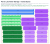

# Pan & Lid Drawer Storage


*The finished organizer (2 1/2" fingered parts, 4" plain parts, 1" tabs and slots). The drawer box is shown in gray; the parts have the birch grain and layered plywood edges.*

A drop-in, glue-and-slot storage system for pans and lids, built from 3/8" baltic birch and cut on a laser.
Nothing is attached to the drawer: the assembly simply fills it and holds itself in place.

Everything here is generated from three small Python scripts, so any dimension can be changed and the
drawings and the nested cut files regenerate together.

| File | What it is |
|---|---|
| [`drawer.py`](drawer.py) | Geometry + drawing: plan, elevations, 3D perspective and parts sheet → `drawer.svg` |
| [`nest.py`](nest.py) | Nests every part onto a sheet, checks the layout, writes the preview and cut files |
| [`perspective.py`](perspective.py) | Wood-look perspective render of the assembly → `perspective.svg` |
| [`perspective.svg`](perspective.svg) | The birch plywood render (above) |
| [`drawer.svg`](drawer.svg) | The design drawing (below) |
| [`layout_48x34in.svg`](layout_48x34in.svg) | Colour preview of the nested sheet |
| [`cut_48x34in_sheet1.svg`](cut_48x34in_sheet1.svg) | 1:1 cut file, 48" × 34", hairline outlines in three colour groups (holes, fingered parts, plain parts), no fill |
| [`CLEARANCE.md`](CLEARANCE.md) | Every fit that needs an explicit clearance, and what the model currently assumes |

## The design drawing


## The nested layout



One 48" × 34" sheet holds the whole system: 2 supports, 4 rail outer plies, 4 rail inner plies,
**7 divider A and 7 divider B**. The layout passes the built-in overlap check (smallest gap between parts
0.214", smallest edge padding 0.250").

## Inputs

| Input | Value |
|---|---|
| Drawer interior | 32 3/8" wide (side to side) × 20" deep (front to back) × 9 1/2" tall |
| Material | 3/8" baltic birch plywood (modelled as exactly 0.375"), cut on a laser |
| Sheet size | 48" × 34" |
| Rail pairs | Two pairs; inner faces toward each other; **13"** and **10"** wide gaps requested |
| Dividers | Fit into slots in the rails; at least 5 of each size, more if they fit (final: 7 each) |

## How the system works

Two supports span the drawer at the front and back, four rails run between them with their tabs in the
support slots, and dividers drop into the rail slots. The drawing above shows how they fit together.

### Heights and how the tops line up
Two heights: the **fingered parts** (supports and rail inner plies) are **2 1/2"** tall; the **plain parts**
(rail outer plies and dividers) are **4"** tall. Slots and tabs are **1"** deep/tall. All tops are flush at
4" above the drawer floor, so the supports and inner plies hang 1 1/2" above the floor: the supports rest on
the bottoms of the outer-ply tabs in their slots, and the inner plies are glued to the outer plies. The
rails and dividers stand on the floor.

### Supports (2)
- Run the full width (32 3/8"), one at the front and one at the back, 3/8" thick, 2 1/2" tall.
- **31 slots**, 3/8" wide, on **1" centers**, first slot 1" from the end. Slot depth equals the tab height.
- They fix the assembly side to side; the rails fix it front to back.

### Rails (4, in two pairs)
Each rail is two 3/8" plies glued into one 3/4" rail.
- **Outer ply** – structural, no slots, 4" tall. Full 20" long at the tabs: the end tabs (3/8" long, 1" tall)
  pass through the support slots. The body between the supports is 19 1/4".
- **Inner ply** – 2 1/2" tall, 19 1/4" long (fits between the supports, no tabs). **24 slots**, 3/8" wide, on **3/4"
  centers**, centred along the length, for the dividers. The 3/8" teeth between slots are backed by the
  outer ply, which carries the divider loads through the glue joint.
- **5 alignment dowel holes**, 1/4" diameter, through both plies for glue-up registration, at
  1", 5 1/2", 10", 14 1/2" and 19" from the front. They sit mid-spine on the inner ply (3/4" up, between the
  1 1/2" spine's edges, below the slot floors), which is 2 1/4" above the bottom of the outer ply. The pattern
  is symmetric so a ply can be flipped.
- Rail position is set by the support slots, so the gap between a pair is a whole number of inches minus
  1 1/8": **12 7/8"** and **9 7/8"** (the closest to the requested 13" and 10"). Spare width is 2" at
  the left, 2 5/8" in the middle and 2" at the right.

### Dividers
- **Divider A** for the 12 7/8" gap: 12 7/8" body, 13 5/8" over the tabs.
- **Divider B** for the 9 7/8" gap: 9 7/8" body, 10 5/8" over the tabs.
- 3/8" thick, 4" tall, tabs 3/8" long and 1" tall, tabs drop into the rail inner-ply slots. Removable; position them anywhere on
  the 3/4" slot grid.

### Part sizes

| Part | Qty | Size (length × height × thickness) | Notes |
|---|---|---|---|
| Support | 2 | 32 3/8" × 2 1/2" × 3/8" | 31 slots, 3/8" × 1" deep, 1" centers |
| Rail outer ply | 4 | 20" × 4" × 3/8" | tabs 1" tall × 3/8" long, 19 1/4" body, 5 dowel holes |
| Rail inner ply | 4 | 19 1/4" × 2 1/2" × 3/8" | 24 slots 3/8" × 1" deep, 3/4" centers, 5 dowel holes |
| Divider A | 7 | 13 5/8" (tabs) / 12 7/8" (body) × 4" × 3/8" | tabs 1" tall |
| Divider B | 7 | 10 5/8" (tabs) / 9 7/8" (body) × 4" × 3/8" | tabs 1" tall |

All **outside (convex) corners are rounded to a 1/8" radius**; inside corners (slot bottoms, tab steps)
are left sharp because the laser cuts them cleanly.

## Decisions, in the order they were made

1. **Rails: tabs on the outer ply only.** Originally both plies had tabs. Making the inner ply stop between
   the supports let the support slots shrink from 3/4" to 3/8" wide.
2. **Support slot pitch: 1".** 1 1/2" centers were considered for stronger teeth, but they would put the
   gaps 5/8" away from 13"/10" (12 3/8" and 9 3/8"). On the 1" grid they are 1/8" off, and a 5/8" tooth
   carries about 410 psi at the root under a 20 lb sideways push, well within the plywood's capacity.
3. **Rail slot pitch: 3/4", 24 slots.** Tooth width 3/8" (half the 3/4" pitch) is acceptable because the
   teeth are glued to the full-height outer ply. 25 slots would fit but leave only 7/16" end pieces; 24
   leaves 13/16".
4. **Rounded corners, 1/8".** First on tabs and fingers, then on every outside corner of every part.
5. **Dowel holes.** 3, then 5, 1/4" holes; the outer pair were later moved to 5/8" in from the body ends.
6. **Slot depth follows tab height.** Slot depth is defined as tab height plus a clearance (`SLOT_CLR`,
   currently 0). Tabs and slots started at 2", went to 1 3/4" for nesting, and are now **1"**.
7. **Two heights (latest change).** Fingered parts 2 1/2", plain parts 4", tops flush. This replaced the
   single 3.75" strip height. The dowel holes moved from 1" up to mid-spine (3/4" up the inner ply,
   2 1/4" up the outer ply): at 1" they would have landed inside the fingers of the shorter inner ply,
   leaving 1/16" of wood beside each hole.

### Rail deflection check
*Worked out for the earlier 3.75" geometry. With the 4" outer ply and 2 1/2" inner ply (1" slots) I is about 0.106 in⁴, so the deflections below hold; the 250 lb tab-engagement estimate was not re-derived for the 1" tabs.*

Treating a rail as a simply supported beam on edge, 19 1/4" span, I ≈ 0.10 in⁴ (slots included),
E ≈ 1.0 × 10⁶ psi (0.6 × 10⁶ for weak-grain orientation):

| Sideways load on one rail | Midspan deflection (E = 1.0M / 0.6M) |
|---|---|
| 10 lb spread along the rail | 0.009" / 0.015" |
| 20 lb at midspan | 0.030" / 0.050" |
| 50 lb at midspan | 0.074" / 0.124" |

3/8" (the tab engagement) would take roughly 250 lb (150 lb weak grain) at midspan, so no reinforcement
or bracing is needed.

## Nesting decisions

- **Sheet:** 48" × 34", parts run along the 48" side, 1/4" minimum padding at all four edges. Shorter is too
  short: a 33" sheet would leave 0.07" between rows.
- **Grain:** along the 48" side, so it runs across the strips and **along the fingers** (the strong
  direction). The rails run across the grain along their length, which the deflection check above covers.
- **Why not one row per part:** at two heights, single-height rows need about 47" of the 33.5" available
  across the sheet. Three 2 1/2" strips (7.5" plus two gaps) fit in the same height as two 4" rows (8" plus a
  gap), so the layout is built from **bands** two plain rows tall, each holding a stack of three fingered
  strips beside two plain rows.
- **Layout (top to bottom):**

  | Unit | Left | Right |
  |---|---|---|
  | Band 1 | support, support, rail inner ply (stack of three) | divider A in each of two rows |
  | Band 2 | rail inner ply × 3 (stack of three) | 2 rows, each an interlocked pair of divider A |
  | Row 5 | rail outer ply, divider A, divider B (interlocked) | |
  | Rows 6–8 | rail outer ply, divider B, divider B (interlocked) | |

- **Gap between rows: 0.214".** The spare height (34" − 2 × 1/4" − 8 × 4" = 1.5") is spread over the 7 gaps.
  The three strips of a fingered stack are spread evenly over the band.
- **Interlocking:** rail outer plies and dividers alternate 180° along a row so their stepped ends interlock,
  saving 3/8" per joint. With 1" tabs the tab tip stays 2" clear of the neighbour's notch floor.
- **Fingers:** within a stack the fingers face away from each other or at the solid back of the next strip,
  never at another strip's fingers. The fingered strips are not flanked by uncut plain stock any more, so
  the cut order below matters more.
- **Row spacing equalized.** In each plain row the left padding, every gap between parts and the right
  padding are the same size.

### Cut order

The cut file has three groups, each a different colour, so the laser software shows them as three layers
that can be ordered:

1. **Red: the 40 dowel holes.** Cut first, while the sheet is intact, so they are accurate relative to
   the outlines.
2. **Blue: the fingered parts** (2 supports, 4 rail inner plies). The thin fingers and the slivers of
   waste between them are cut while the neighbouring plain parts are still uncut, solid stock. Some of
   the fingered strips neighbour each other (in the stacks) rather than plain stock; the fingers are still
   supported by the uncut spine of the next strip.
3. **Green: the plain parts** (4 rail outer plies, 14 dividers), simple outlines last.

Do not move or unload the sheet between passes; after pass 2 the fingered parts are loose in the sheet.

- **Layout check.** `nest.py` tests every pair of parts for crossing outlines, containment or a gap under
  the minimum, plus the edge padding, the clearance around the dowel holes, and that all 2 + 4 + 4 + 7 + 7
  parts are present. A failure is circled in red on the preview, printed, and the script exits non-zero.

## Regenerating

```bash
python3 drawer.py        # drawer.svg
python3 perspective.py   # perspective.svg (wood look)
python3 nest.py          # layout_48x34in.svg + cut_48x34in_sheet1.svg, with the layout check
```

`nest.py [gap]` takes an optional row gap in inches (default: spread the spare sheet height evenly);
`SHEET_H` sets the sheet length (default 34). Heights and tab depth are `H_FING`, `H_PLAIN` and `TAB_T` at
the top of `drawer.py`.

## Open items

- **Clearances are all zero** (nominal sizes everywhere). See [CLEARANCE.md](CLEARANCE.md) for every fit
  that needs a value, pending the measured plywood thickness and the laser's kerf.
- The 3D view draws the dividers as plain boxes (no rounded corners shown).
- Compartment layout for the actual pans and lids is the next step.
