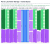

# Pan & Lid Drawer Storage


*The finished organizer at its final geometry (3.75" strips, 1 3/4" tabs and slots). The drawer box is shown in gray; the parts have the birch grain and layered plywood edges.*

A drop-in, glue-and-slot storage system for pans and lids, built from 3/8" baltic birch and cut on a laser.
Nothing is attached to the drawer: the assembly simply fills it and holds itself in place.

Everything here is generated from three small Python scripts, so any dimension can be changed and the
drawings and the nested cut files regenerate together.

| File | What it is |
|---|---|
| [`drawer.py`](drawer.py) | Geometry + drawing: plan, elevations, 3D perspective and parts sheet → `drawer.svg` |
| [`nest.py`](nest.py) | Nests every part onto a sheet, checks the layout, writes the preview and cut files |
| [`perspective.py`](perspective.py) | Wood-look perspective render of the assembly → `perspective.svg` |
| [`perspective.svg`](perspective.svg) | The birch plywood render (above) |
| [`drawer.svg`](drawer.svg) | The design drawing (below) |
| [`layout_short_extra_row_h3.75_gap0.227_equal_34in.svg`](layout_short_extra_row_h3.75_gap0.227_equal_34in.svg) | Colour preview of the nested sheet |
| [`cut_short_extra_row_h3.75_gap0.227_equal_34in_sheet1.svg`](cut_short_extra_row_h3.75_gap0.227_equal_34in_sheet1.svg) | 1:1 cut file, 48" × 34", hairline outlines in three colour groups (holes, fingered parts, plain parts), no fill |
| [`CLEARANCE.md`](CLEARANCE.md) | Every fit that needs an explicit clearance, and what the model currently assumes |

## The design drawing


## The nested layout



One 48" × 34" sheet holds the whole system: 2 supports, 4 rail outer plies, 4 rail inner plies,
**7 divider A and 7 divider B**. The layout passes the built-in overlap check (smallest gap between parts
0.227", smallest edge padding 0.250").

## Inputs

| Input | Value |
|---|---|
| Drawer interior | 32 3/8" wide (side to side) × 20" deep (front to back) × 9 1/2" tall |
| Material | 3/8" baltic birch plywood (modelled as exactly 0.375"), cut on a laser |
| Sheet size | 48" × 34" (arrived at after trying 48 × 32, 48 × 33 and 48 × 35; see below) |
| Rail pairs | Two pairs; inner faces toward each other; **13"** and **10"** wide gaps requested |
| Dividers | Fit into slots in the rails; at least 5 of each size, more if they fit (final: 7 each) |

## How the system works

Two supports span the drawer at the front and back, four rails run between them with their tabs in the
support slots, and dividers drop into the rail slots. The drawing above shows how they fit together.

### Supports (2)
- Run the full width (32 3/8"), one at the front and one at the back, 3/8" thick.
- **31 slots**, 3/8" wide, on **1" centers**, first slot 1" from the end. Slot depth equals the tab height.
- They fix the assembly side to side; the rails fix it front to back.

### Rails (4, in two pairs)
Each rail is two 3/8" plies glued into one 3/4" rail.
- **Outer ply** – structural, no slots. Full 20" long at the tabs: the end tabs (3/8" long) pass through the
  support slots. The body between the supports is 19 1/4".
- **Inner ply** – 19 1/4" long (fits between the supports, no tabs). **24 slots**, 3/8" wide, on **3/4"
  centers**, centred along the length, for the dividers. The 3/8" teeth between slots are backed by the
  outer ply, which carries the divider loads through the glue joint.
- **5 alignment dowel holes**, 1/4" diameter, through both plies for glue-up registration, at
  1", 5 1/2", 10", 14 1/2" and 19" from the front, 1" up. The pattern is symmetric so a ply can be flipped.
- Rail position is set by the support slots, so the gap between a pair is a whole number of inches minus
  1 1/8": **12 7/8"** and **9 7/8"** (the closest to the requested 13" and 10"). Spare width is 2" at
  the left, 2 5/8" in the middle and 2" at the right.

### Dividers
- **Divider A** for the 12 7/8" gap: 12 7/8" body, 13 5/8" over the tabs.
- **Divider B** for the 9 7/8" gap: 9 7/8" body, 10 5/8" over the tabs.
- 3/8" thick, tabs 3/8" long, tabs drop into the rail inner-ply slots. Removable; position them anywhere on
  the 3/4" slot grid.

### Part sizes at the final 3.75" strip height

| Part | Qty | Size (length × height × thickness) | Notes |
|---|---|---|---|
| Support | 2 | 32 3/8" × 3.75" × 3/8" | 31 slots, 3/8" × 1 3/4" deep, 1" centers |
| Rail outer ply | 4 | 20" × 3.75" × 3/8" | tabs 1 3/4" tall × 3/8" long, 19 1/4" body, 5 dowel holes |
| Rail inner ply | 4 | 19 1/4" × 3.75" × 3/8" | 24 slots 3/8" × 1 3/4" deep, 3/4" centers, 5 dowel holes |
| Divider A | 7 | 13 5/8" (tabs) / 12 7/8" (body) × 3.75" × 3/8" | tabs 1 3/4" tall |
| Divider B | 7 | 10 5/8" (tabs) / 9 7/8" (body) × 3.75" × 3/8" | tabs 1 3/4" tall |

All **outside (convex) corners are rounded to a 1/8" radius**; inside corners (slot bottoms, tab steps)
are left sharp because the laser cuts them cleanly.

## Decisions, in the order they were made

1. **Rails: tabs on the outer ply only.** Originally both plies had tabs. Making the inner ply stop between
   the supports let the support slots shrink from 3/4" to 3/8" wide.
2. **Support slot pitch: 1".** 1 1/2" centers were considered for stronger teeth, but they would put the
   gaps 5/8" away from 13"/10" (12 3/8" and 9 3/8"). On the 1" grid they are 1/8" off, and a 5/8" tooth
   carries about 410 psi at the root under a 20 lb sideways push, well within the plywood's capacity.
3. **Rail slot pitch: 3/4", 24 slots.** Tooth width 3/8" (half the 3/4" pitch) is acceptable because the
   teeth are glued to the full-height outer ply. 25 slots would fit but leave only 7/16" end pieces; 24
   leaves 13/16".
4. **Rounded corners, 1/8".** First on tabs and fingers, then on every outside corner of every part.
5. **Dowel holes.** 3, then 5, 1/4" holes; the outer pair were later moved to 5/8" in from the body ends.
6. **Slot depth follows tab height.** Tabs had to be shortened for nesting (below), so slot depth is now
   defined as tab height plus a clearance (`SLOT_CLR`, currently 0).

### Rail deflection check
Treating a rail as a simply supported beam on edge, 19 1/4" span, I ≈ 0.10 in⁴ (slots included),
E ≈ 1.0 × 10⁶ psi (0.6 × 10⁶ for weak-grain orientation):

| Sideways load on one rail | Midspan deflection (E = 1.0M / 0.6M) |
|---|---|
| 10 lb spread along the rail | 0.009" / 0.015" |
| 20 lb at midspan | 0.030" / 0.050" |
| 50 lb at midspan | 0.074" / 0.124" |

3/8" (the tab engagement) would take roughly 250 lb (150 lb weak grain) at midspan, so no reinforcement
or bracing is needed.

## Nesting decisions

- **Sheet:** 48" × 34". Started at 48 × 32, but the 32 3/8" supports don't fit across 32", so parts were
  turned 90° so they run along the 35"/34" side. 34" is the shortest sheet that still holds 7 + 7 dividers
  (the limiting row is a rail outer ply beside a divider A, 33.47" + 2 × 1/4" padding).
- **Grain:** along the 48" side, so it runs across the strips and **along the fingers** (the strong
  direction). The rails run across the grain along their length, which the deflection check above covers.
- **Padding:** 1/4" minimum at all four sheet edges.
- **Strip height: 3.75"** (down from 4"). At 4", one more strip row does not fit; each orientation needs a
  slightly shorter strip to gain a row, and the extra row is what fits 7 + 7 dividers on one sheet.
  The 3.75" strips give 12 rows across the 48" side.

  | Orientation (sheet 48 × 35) | Rows at 4" | Strip for +1 row | Dividers A / B at 4" | With the extra row |
  |---|---|---|---|---|
  | Parts along the 48" side | 8 | 3 23/32" | 5 / 5 | 7 / 7 |
  | Parts along the 35" side (chosen) | 11 | 3 27/32" | 5 / 6 | 7 / 7 |

- **Gap between rows: 0.227".** The spare strip space (48" − 2 × 1/4" − 12 × 3.75" = 2.5") is spread over
  the 11 gaps between rows.
- **Tab height 1 3/4".** Rail outer plies and dividers alternate 180° along a row so their stepped ends
  interlock, saving 3/8" per joint. For the interlocked tab and notch to keep a gap, the tab must be
  shorter than half the strip height minus the gap, so tabs are `floor32((strip − gap) / 2)`. At 4" strips
  with 2" tabs the tabs sat exactly on each other's cut line.
- **Row spacing equalized.** In each row the left padding, every gap between parts and the right padding
  are all the same size; a lone part is centred.
- **Row order.** The two supports are in the middle, flipped so their fingers face away from each other.
  Working outward in each direction, plain rows (rail outer plies, dividers) alternate with fingered rows
  (rail inner plies). Every fingered row is flanked by plain stock on both sides, and its fingers always
  face a plain row. Reading the layout across the sheet:

  | Row | Contents | Space (pad = gap) |
  |---|---|---|
  | 1 | rail outer + divider A | 1/4" (tight) |
  | 2 | rail inner + divider A | 3/8" |
  | 3 | rail outer + divider A | 1/4" |
  | 4 | rail inner + divider A | 3/8" |
  | 5 | 3 × divider B | 23/32" |
  | 6–7 | support (fingers face away from each other) | 13/16" at each end |
  | 8 | 3 × divider B | 23/32" |
  | 9 | rail inner + divider A | 3/8" |
  | 10 | rail outer + divider B | 1 1/4" |
  | 11 | rail inner + divider A | 3/8" |
  | 12 | rail outer + divider A | 1/4" (tight) |

### Cut order

The cut file has three groups, each a different colour, so the laser software shows them as three layers
that can be ordered:

1. **Red: the 40 dowel holes.** Cut first, while the sheet is intact, so they are accurate relative to
   the outlines.
2. **Blue: the fingered parts** (2 supports, 4 rail inner plies). The thin fingers and the slivers of
   waste between them are cut while the neighbouring plain parts are still uncut, solid stock.
3. **Green: the plain parts** (4 rail outer plies, 14 dividers), simple outlines last.

Do not move or unload the sheet between passes; after pass 2 the fingered parts are loose in the sheet.

- **Layout check.** `nest.py` tests every pair of parts for crossing outlines, containment or a gap under
  the minimum, plus the edge padding and the clearance around the dowel holes. A failure is circled in red
  on the preview, printed, and the script exits non-zero. It caught the original zero-gap tabs at 4".

## Regenerating

```bash
python3 drawer.py                                     # drawer.svg (final 3.75" parts)
python3 perspective.py                                # perspective.svg (wood look)
SHEET_H=34 python3 nest.py short 3.75 7 max equal order   # the final nested layout + cut file
```

`nest.py` arguments: `long|short [strip_height [dividers_of_each_size [gap|auto|max [spread|equal [order]]]]]`
(`SHEET_H` environment variable sets the sheet length; default 35). `long` runs parts along the 48" side,
`short` along the 34"/35" side. For example `python3 nest.py long` gives the 4" strip layout with parts
along the 48" side.

## Open items

- **Clearances are all zero** (nominal sizes everywhere). See [CLEARANCE.md](CLEARANCE.md) for every fit
  that needs a value, pending the measured plywood thickness and the laser's kerf.
- The 3D view draws the dividers as plain boxes (no rounded corners shown).
- Compartment layout for the actual pans and lids is the next step.
