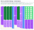

# Pan & Lid Drawer Storage


*The finished organizer (3" slotted parts, 4" plain parts, 1 1/2" fingers and slots). The drawer box is shown in gray; the parts have the birch grain and layered plywood edges.*

A drop-in, glue-and-slot storage system for pans and lids, built from 3/8" baltic birch and cut on a laser.
Nothing is attached to the drawer: the assembly simply fills it and holds itself in place.

Everything here is generated from three small Python scripts, so any dimension can be changed and the
drawings and the nested cut files regenerate together.

| File | What it is |
|---|---|
| [`drawer.py`](drawer.py) | Geometry + drawing: plan, elevations, 3D perspective and parts sheet → `drawer.svg` |
| [`nest.py`](nest.py) | Nests every part onto a sheet, checks the layout, writes the preview and cut files |
| [`perspective.py`](perspective.py) | Wood-look perspective render of the assembly → `perspective.svg` |
| [`perspective.svg`](perspective.svg) | The birch plywood render (above) |
| [`drawer.svg`](drawer.svg) | The design drawing (below) |
| [`layout_short_x3.svg`](layout_short_x3.svg) | Colour preview of the nested sheet |
| [`cut_short_x3_sheet1.svg`](cut_short_x3_sheet1.svg) | 1:1 cut file, 48" × 34", hairline outlines in three colour groups (holes, fingered parts, plain parts), no fill |
| [`CLEARANCE.md`](CLEARANCE.md) | Every fit that needs an explicit clearance, and what the model currently assumes |

## The design drawing


## The nested layout



One 48" × 34" sheet holds the whole system: 2 supports, 4 rail outer plies, 4 rail inner plies,
**7 divider A and 7 divider B**. The layout passes the built-in overlap check (smallest gap between parts
0.125", the minimum; smallest edge padding 0.250").

## Inputs

| Input | Value |
|---|---|
| Drawer interior | 32 3/8" wide (side to side) × 20" deep (front to back) × 9 1/2" tall |
| Material | 3/8" baltic birch plywood (modelled as exactly 0.375"), cut on a laser |
| Sheet size | 48" × 34" |
| Rail pairs | Two pairs; inner faces toward each other; **13"** and **10"** wide gaps requested |
| Dividers | Fit into slots in the rails; at least 5 of each size, more if they fit (final: 7 each) |

## How the system works

Two supports span the drawer at the front and back, four rails run between them with their tabs in the
support slots, and dividers drop into the rail slots. The drawing above shows how they fit together.

### Heights and how the parts meet
Everything is set by one number, `x`, the height of the **slotted parts** (supports and rail inner plies);
the **plain parts** (rail outer plies and dividers) are `x + 1` tall and the **fingers and slots** are `x / 2`
deep. `x` is as large as the sheet allows (see Nesting): **x = 3"**, so the slotted parts are 3" tall, the plain
parts 4" tall, and the fingers and slots 1 1/2". Everything stands on the drawer floor. The slots are open at
the top of the slotted parts, between 1 1/2" and 3" up, so the tabs of the plain parts start at the slot floor,
1 1/2" up, and run to the top of the 4" part (2 1/2" tall); the lower 1 1/2" of each tab sits in a slot and the
rest rises above the support or inner ply. The plain parts are lowered in from above, and their bodies rise 1"
above the supports and inner plies.

### Supports (2)
- Run the full width (32 3/8"), one at the front and one at the back, 3/8" thick, 3" tall.
- **31 slots**, 3/8" wide, on **1" centers**, first slot 1" from the end. Slot depth equals the tab height.
- They fix the assembly side to side; the rails fix it front to back.

### Rails (4, in two pairs)
Each rail is two 3/8" plies glued into one 3/4" rail.
- **Outer ply** – structural, no slots, 4" tall. Full 20" long at the tabs: the end tabs (3/8" long, 2 1/2" tall, from
  1 1/2" up to the top) pass through the support slots. The body between the supports is 19 1/4".
- **Inner ply** – 3" tall, 19 1/4" long (fits between the supports, no tabs). **24 slots**, 3/8" wide, on **3/4"
  centers**, centred along the length, for the dividers. The 3/8" teeth between slots are backed by the
  outer ply, which carries the divider loads through the glue joint.
- **5 alignment dowel holes**, 1/4" diameter, through both plies for glue-up registration, at
  1", 5 1/2", 10", 14 1/2" and 19" from the front, all 3/4" up from the bottom. That is mid-spine on the
  inner ply (the 1 1/2" of solid wood below the slot floors, `x / 4` up). The pattern is symmetric so a ply can be flipped.
- Rail position is set by the support slots, so the gap between a pair is a whole number of inches minus
  1 1/8": **12 7/8"** and **9 7/8"** (the closest to the requested 13" and 10"). Spare width is 2" at
  the left, 2 5/8" in the middle and 2" at the right.

### Dividers
- **Divider A** for the 12 7/8" gap: 12 7/8" body, 13 5/8" over the tabs.
- **Divider B** for the 9 7/8" gap: 9 7/8" body, 10 5/8" over the tabs.
- 3/8" thick, 4" tall, tabs 3/8" long and 2 1/2" tall (from 1 1/2" up to the top), tabs drop into the rail
  inner-ply slots. Removable; position them anywhere on
  the 3/4" slot grid.

### Part sizes

| Part | Qty | Size (length × height × thickness) | Notes |
|---|---|---|---|
| Support | 2 | 32 3/8" × 3" × 3/8" | 31 slots, 3/8" × 1 1/2" deep, 1" centers |
| Rail outer ply | 4 | 20" × 4" × 3/8" | tabs 2 1/2" tall × 3/8" long, 19 1/4" body, 5 dowel holes |
| Rail inner ply | 4 | 19 1/4" × 3" × 3/8" | 24 slots 3/8" × 1 1/2" deep, 3/4" centers, 5 dowel holes |
| Divider A | 7 | 13 5/8" (tabs) / 12 7/8" (body) × 4" × 3/8" | tabs 2 1/2" tall |
| Divider B | 7 | 10 5/8" (tabs) / 9 7/8" (body) × 4" × 3/8" | tabs 2 1/2" tall |

All **outside (convex) corners are rounded to a 1/8" radius**; inside corners (slot bottoms, tab steps)
are left sharp because the laser cuts them cleanly.

## Decisions, in the order they were made

1. **Rails: tabs on the outer ply only.** Originally both plies had tabs. Making the inner ply stop between
   the supports let the support slots shrink from 3/4" to 3/8" wide.
2. **Support slot pitch: 1".** 1 1/2" centers were considered for stronger teeth, but they would put the
   gaps 5/8" away from 13"/10" (12 3/8" and 9 3/8"). On the 1" grid they are 1/8" off, and a 5/8" tooth
   carries about 410 psi at the root under a 20 lb sideways push, well within the plywood's capacity.
3. **Rail slot pitch: 3/4", 24 slots.** Tooth width 3/8" (half the 3/4" pitch) is acceptable because the
   teeth are glued to the full-height outer ply. 25 slots would fit but leave only 7/16" end pieces; 24
   leaves 13/16".
4. **Rounded corners, 1/8".** First on tabs and fingers, then on every outside corner of every part.
5. **Dowel holes.** 3, then 5, 1/4" holes; the outer pair were later moved to 5/8" in from the body ends.
6. **Slot depth follows tab height.** Slot depth is defined as tab height plus a clearance (`SLOT_CLR`,
   currently 0). Tabs and slots started at 2", went to 1 3/4" for nesting, and are now **1"**.
7. **Two heights, one parameter (latest change).** The slotted parts are `x` tall, the plain parts `x + 1`, the
   fingers and slots `x / 2`, all standing on the floor, with the tabs of the plain parts starting at the slot
   floor and running to the top (`x / 2 + 1` tall). This replaced the single 3.75" strip height. `x` was
   maximised against the sheet and came out at exactly **3"**. The dowel holes moved from 1" up to `x / 4`
   (3/4" up): at 1" they would have landed inside the fingers of the shorter inner ply.

### Rail deflection check
*Worked out for the earlier 3.75" geometry. With the 4" outer ply and 3" inner ply (1 1/2" slots) I is about 0.11 in⁴, so the deflections below hold; the 250 lb tab-engagement estimate was not re-derived for the current tabs.*

Treating a rail as a simply supported beam on edge, 19 1/4" span, I ≈ 0.10 in⁴ (slots included),
E ≈ 1.0 × 10⁶ psi (0.6 × 10⁶ for weak-grain orientation):

| Sideways load on one rail | Midspan deflection (E = 1.0M / 0.6M) |
|---|---|
| 10 lb spread along the rail | 0.009" / 0.015" |
| 20 lb at midspan | 0.030" / 0.050" |
| 50 lb at midspan | 0.074" / 0.124" |

3/8" (the tab engagement) would take roughly 250 lb (150 lb weak grain) at midspan, so no reinforcement
or bracing is needed.

## Nesting decisions

- **Sheet:** 48" × 34", 1/4" minimum padding at all four edges and 1/8" minimum between parts (the sheet is
  fixed; a 36" sheet would not fit the CNC).
- **Maximising x.** With the slotted height `x`, plain `x + 1` and fingers `x / 2`, the part count and lengths
  fix the stack height. The nest packs the parts' bounding boxes with a bottom-left skyline (random part orders,
  then hill climbing on the order, fixed seed), which lets the shorter slotted parts sit beside taller plain
  ones so the next part tucks up under them. `python3 nest.py short --max` scans `x` in 1/16" steps:

  | x (slotted) | plain | fingers | stack needed on the 48" side (limit 48") |
  |---|---|---|---|
  | 2 7/8" | 3 7/8" | 1 7/16" | 46.375" |
  | 2 15/16" | 3 15/16" | 1 15/32" | 47.188" |
  | **3"** | **4"** | **1 1/2"** | **48.000"** (no spare) |
  | 3 1/16" | 4 1/16" | 1 17/32" | 48.812" (does not fit) |

  So **x = 3" is the largest that nests**, with exactly 1/8" gaps and 1/4" padding and nothing to spare. The
  search is heuristic, so a smarter packing could in principle gain a little more; it did not in any run.
- **Orientation:** the parts run along the **34" side** and are stacked along the 48" side, so a grain running
  along the 48" side runs across the parts and **along the fingers** (the strong direction). The other orientation
  (`python3 nest.py long`, parts along the 48" side, fingers across a 48" grain) tops out at x = 2 15/16".
- **No interlocking:** the tabs of the plain parts are taller than the notch beside them (`x / 2 + 1` against
  `x / 2`), so neighbouring rail outer plies and dividers cannot nest their tabs into each other's notches and
  each part takes its full length.
- **Fingers:** each fingered part is turned so its fingers face plain stock or the sheet edge, not another
  fingered part's fingers, wherever the packing allows.
- **No spare:** the packing is exactly tight, so any increase in the padding, gap, or part sizes (for example a
  clearance, see [CLEARANCE.md](CLEARANCE.md)) will push `x` below 3".

### Cut order

The cut file has three groups, each a different colour, so the laser software shows them as three layers
that can be ordered:

1. **Red: the 40 dowel holes.** Cut first, while the sheet is intact, so they are accurate relative to
   the outlines.
2. **Blue: the fingered parts** (2 supports, 4 rail inner plies). The thin fingers and the slivers of
   waste between them are cut while the neighbouring plain parts are still uncut, solid stock. Where
   several fingered parts sit side by side the fingers face the next part's spine, not its fingers.
3. **Green: the plain parts** (4 rail outer plies, 14 dividers), simple outlines last.

Do not move or unload the sheet between passes; after pass 2 the fingered parts are loose in the sheet.

- **Layout check.** `nest.py` tests every pair of parts for crossing outlines, containment or a gap under
  the minimum, plus the edge padding, the clearance around the dowel holes, and that all 2 + 4 + 4 + 7 + 7
  parts are present. A failure is circled in red on the preview, printed, and the script exits non-zero.

## Regenerating

```bash
python3 drawer.py        # drawer.svg
python3 perspective.py   # perspective.svg (wood look)
python3 nest.py          # layout_short_x3.svg + cut_short_x3_sheet1.svg, with the layout check
python3 nest.py short --max   # the largest slotted height x that nests (1/16" steps)
```

`nest.py [short|long]` picks the orientation (default `short`). The slotted height is `x` (`X_FING` in the
environment, default 3, at the top of `drawer.py`); the plain height and the finger depth follow from it, so
for example `X_FING=2.875 python3 drawer.py` and `X_FING=2.875 python3 nest.py` regenerate everything at 2 7/8".

## Open items

- **Clearances are all zero** (nominal sizes everywhere). See [CLEARANCE.md](CLEARANCE.md) for every fit
  that needs a value, pending the measured plywood thickness and the laser's kerf.
- The 3D view draws the dividers as plain boxes (no rounded corners shown).
- Compartment layout for the actual pans and lids is the next step.
