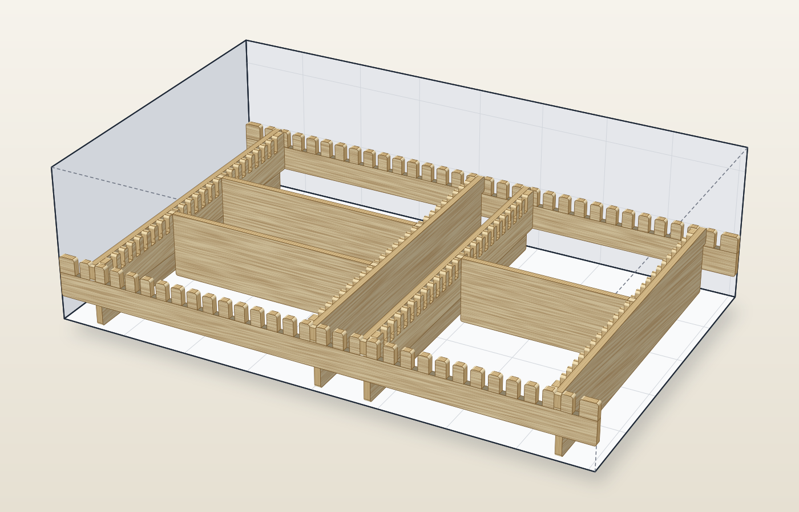
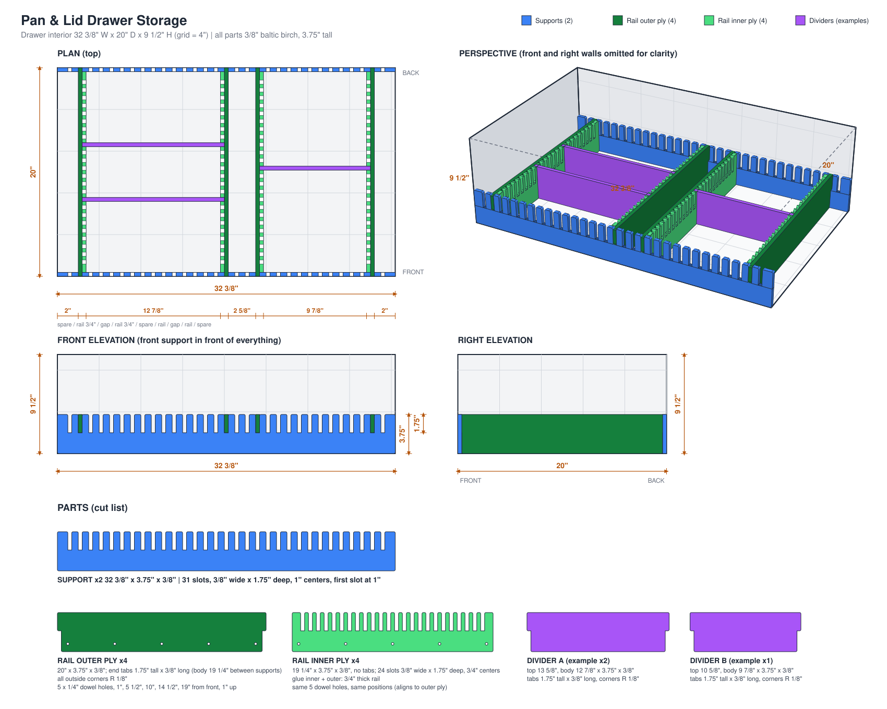
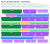

# Pan & Lid Drawer Storage



*The finished organizer (3" slotted parts and divider B, 4" rail outer plies and divider A, 1 1/2" fingers and slots). The drawer box is shown in gray; the parts have the birch grain and layered plywood edges.*

A drop-in, glue-and-slot storage system for pans and lids, built from 3/8" baltic birch and cut on a laser.
Nothing is attached to the drawer: the assembly simply fills it and holds itself in place.

Everything here is generated from three small Python scripts, so any dimension can be changed and the
drawings and the nested cut files regenerate together.

| File | What it is |
|---|---|
| [`drawer.py`](drawer.py) | Geometry + drawing: plan, elevations, 3D perspective and parts sheet → `drawer.svg` |
| [`nest.py`](nest.py) | Nests every part onto a sheet, checks the layout, writes the preview and cut files |
| [`perspective.py`](perspective.py) | Wood-look perspective render of the assembly → `perspective.svg` |
| [`perspective.svg`](perspective.svg) | The birch plywood render (above) |
| [`drawer.svg`](drawer.svg) | The design drawing (below) |
| [`layout_long_x3.svg`](layout_long_x3.svg) | Colour preview of the nested sheet |
| [`cut_long_x3_sheet1.svg`](cut_long_x3_sheet1.svg) | 1:1 cut file, 48" × 34", hairline outlines in five colour groups (laser test pieces, engraved labels, holes, fingered parts, plain parts), no fill |
| [`CLEARANCE.md`](CLEARANCE.md) | Every fit that needs an explicit clearance, and what the model currently assumes |

## The design drawing



## The nested layout



One 48" × 34" sheet holds the whole system: 2 supports, 4 rail outer plies, 4 rail inner plies,
**6 divider A and 8 divider B**, plus **6 test pieces** and **29 laser test pieces** ("9" shapes) (see below). The layout passes the built-in overlap check (smallest gap between parts
0.125", the minimum; smallest edge padding 0.250").

## Inputs

| Input | Value |
|---|---|
| Drawer interior | 32 3/8" wide (side to side) × 20" deep (front to back) × 9 1/2" tall |
| Material | 3/8" baltic birch plywood, measured 9.4 mm (0.370"), cut on a laser; the laser software applies the kerf offset |
| Sheet size | 48" × 34" |
| Rail pairs | Two pairs; inner faces toward each other; **13"** and **10"** wide gaps requested |
| Dividers | Fit into slots in the rails; at least 5 of each size, more if they fit (final: 6 A and 8 B) |

## How the system works

Two supports span the drawer at the front and back, four rails run between them with their tabs in the
support slots, and dividers drop into the rail slots. The drawing above shows how they fit together.

### Heights and how the parts meet
Everything is set by one number, `x`, the height of the **slotted parts** (supports and rail inner plies). The
**rail outer plies and divider A** are `x + 1` tall, **divider B is `x` tall** (the same as the slotted parts),
and the **fingers and slots** are `x / 2` deep. The sheet allows `x` up to 3 1/8" (see Nesting); the design uses
**x = 3"**, which leaves room for generous gaps: the slotted parts and divider B are 3" tall, the rail outer plies
and divider A 4", and the fingers and slots 1 1/2". Everything stands on the drawer floor. The slots are open at
the top of the slotted parts, between 1 1/2" and 3" up, and the tabs start 1/16" above the slot floor, at 1 9/16", so
they never bottom out, and run to the top of the part: 2 7/16" tall on the rail outer plies and divider A, 1 7/16" on
divider B (which ends flush with the inner plies). The fits are listed in [CLEARANCE.md](CLEARANCE.md). The parts are lowered in from above, and the rail outer plies and divider A rise 1" above the
supports and inner plies.

### Supports (2)
- Run the full width (32 3/8"), one at the front and one at the back, 3/8" thick, 3" tall.
- **31 slots**, 3/8" wide, on **1" centers**, first slot 1" from the end. Slot depth equals the tab height.
- They fix the assembly side to side; the rails fix it front to back.

### Rails (4, in two pairs)
Each rail is two 3/8" plies glued into one 3/4" rail.
- **Outer ply** – structural, no slots, 4" tall. 19.938" long at the tabs: the end tabs (0.354" long, 2 7/16" tall, from
  1 9/16" up to the top) pass through the support slots and stop 1/32" short of the drawer wall. The body between
  the supports is 19.229" (1/32" shorter than the space).
- **Inner ply** – 3" tall, 19.229" long (fits between the supports, no tabs). **24 slots**, `T` + `SLIP` wide, on **3/4"
  centers**, centred along the length, for the dividers. The 3/8" teeth between slots are backed by the
  outer ply, which carries the divider loads through the glue joint.
- **5 alignment dowel holes**, 1/4" diameter, through both plies for glue-up registration, at
  1", 5 1/2", 10", 14 1/2" and 19" from the front, all 3/4" up from the bottom. That is mid-spine on the
  inner ply (the 1 1/2" of solid wood below the slot floors, `x / 4` up). The pattern is symmetric so a ply can be flipped.
- Rail position is set by the support slots, so the gap between a pair is a whole number of inches minus
  three plywood thicknesses: **12.890"** and **9.890"** (the closest to the requested 13" and 10"). Spare width is 2" at
  the left, 2 5/8" in the middle and 2" at the right.

### Dividers
- **Divider A** for the 12.890" gap: 12.859" body, 13.567" over the tabs.
- **Divider B** for the 9.890" gap: 9.859" body, 10.567" over the tabs.
- The bodies are 1/32" shorter than the gap, and the tabs stop 1/32" short of the outer ply. Divider A is 4" tall
  with tabs 2 7/16" tall (from 1 9/16" up to the top); divider B is 3" tall with tabs 1 7/16" tall. The tabs drop into the rail inner-ply slots. Removable; position them anywhere on
  the 3/4" slot grid.

### Part sizes

| Part | Qty | Size (length × height × thickness) | Notes |
|---|---|---|---|
| Support | 2 | 32 3/8" × 3" × 0.370" | 31 slots, `T` + `SLIP` × 1 1/2" deep, 1" centers |
| Rail outer ply | 4 | 19.938" × 4" × 0.370" | tabs 2 7/16" tall × 0.354" long, 19.229" body, 5 dowel holes |
| Rail inner ply | 4 | 19.229" × 3" × 0.370" | 24 slots `T` + `SLIP` × 1 1/2" deep, 3/4" centers, 5 dowel holes |
| Divider A | 6 | 13.567" (tabs) / 12.859" (body) × 4" × 0.370" | tabs 2 7/16" tall |
| Divider B | 8 | 10.567" (tabs) / 9.859" (body) × 3" × 0.370" | tabs 1 7/16" tall |
| Test piece | 4 | 8 1/2" × 1 7/16" × 3/8" | 11 slots 1/2" deep, 21 dowel holes and engraved offset labels (not part of the system) |
| Fine test piece | 2 | 4" × 3" × 3/8" | 5 slots 1 1/2" deep (−0.06 to +0.06 mm), engraved offsets, no holes (not part of the system) |

All **outside (convex) corners are rounded to a 1/8" radius**; inside corners (slot bottoms, tab steps)
are left sharp because the laser cuts them cleanly.

### Test pieces (6, not part of the system)

Four identical **long** strips for finding the slot width and dowel hole size that suit the actual plywood, dowels and
laser, cut from the same sheet. Two sit in the middle of each of the two rows of rail inner plies, where the inner plies
are pushed against the left and right edges of the sheet (`F ITI` in the row list below), so they cost no extra sheet.
The two in a row are stacked with their flat edges facing, one turned upside down, so each one's slots face a plain row.

- 8 1/2" × 1 7/16" × 3/8" (two of them and the 1/8" gap between fill the 3" row).
- **11 slots** in one long edge, **1/2" deep** (much shallower than the real 1 1/2") on **3/4" centers**.
- Each slot has a **dowel hole directly under it**, and both share one **offset from nominal**: **−0.5 mm to +0.5 mm in
  0.1 mm steps**, narrowest and smallest at the left, widest and largest at the right. The slot is the measured 9.4 mm + the offset
  (8.9 ... 9.4 ... 9.9 mm) and the hole is 1/4" + the offset (5.85 ... 6.35 ... 6.85 mm).
- Between each pair of those holes is an **unlabelled in-between hole** at the mean offset (−0.45, −0.35 ... +0.45 mm,
  hole 5.90 ... 6.80 mm), so each half has 21 holes. The in-between holes are raised towards the fingers, to
  0.638" from the flat edge (the labelled holes are at 0.334"), the height where the wall to the slot corners and
  the wall to the neighbouring labelled holes are equal: **at least 0.214" (5.4 mm) both ways**, measured edge to edge. The
  narrowest walls are at the large end, around the +0.5 and +0.45 mm holes. (Raising them further widens the wall to
  the other holes but crowds the slots; with all 21 holes in one row the wall was 0.106".) `nest.py` prints the wall.
- The **offset is engraved** between each slot and its hole, in **tenths of a millimetre**: "-5" ... "-1", "0", "+1" ... "+5"
  (so "+3" is +0.3 mm). The fine pieces below are labelled in full ("-0.06"). The lettering is single-line strokes
  (a seven-segment style font drawn as paths, so there is nothing to convert), and reads upright with the slots up.
- `TEST_NOMINAL` at the top of `nest.py` is the thickness the slots are relative to, the measured `T`. The hole
  offsets are relative to the 1/4" dowel. So the label of the best slot is `SLIP` and that of the best hole is
  `DOWEL_SLIP`, in tenths of a mm.

**Fine test pieces (2).** The same idea at a finer scale, in the free end of the two rows that hold a support
(`F SB+U`), one in each row against the sheet edge beside divider B.

- 4" × 3" × 3/8", the same geometry as a rail inner ply: **fingers on the top edge only**, **1 1/2" deep**, on
  3/4" centers, with the solid 1 1/2" spine below. **5 slots**, offset **−0.06, −0.03, 0, +0.03, +0.06 mm** from
  `TEST_NOMINAL` (narrowest on the left), the offset engraved under each slot.
- **No dowel holes.**
- Meant for narrowing down: cut them after the long pieces have shown roughly which offset suits, and set
  `FINE_STEPS_MM` in `nest.py` around that offset (the −0.06 to +0.06 range is relative to the nominal).

Push a scrap of the plywood into each slot and a dowel into each hole, pick the ones that are snug but go in by hand,
  and put those offsets in `SLIP` and `DOWEL_SLIP` at the top of `drawer.py` (see [CLEARANCE.md](CLEARANCE.md)).

### Laser test pieces (29, not part of the system)

Small pieces shaped like a **"9"**, cut **first** to tune the laser's power and speed on the actual plywood before the
real parts, and then measured with calipers to check the kerf offset. Every dimension is a round number:

- **3/4" × 1 1/2"** overall, with 1/8" rounded outside corners (measure across the flats).
- A **1/4" square hole** in the top of the loop (an inside dimension: it comes out too big if the offset is too small).
- A **1/2" square notch** cut in from the left edge, below the loop (inside, 1/2" tall and 1/2" deep).
- Every bar around them is **1/4"** wide: the walls of the loop, the bar under it, the bottom bar and the right side.

The inside corners of the hole and the notch are left sharp. In the cut file each piece's square hole comes before its
outline, so the piece is still held while the hole is cut.

Where they go:
- **10 standing** in a 5 × 2 grid in the middle of the bottom row, which holds four divider B pushed out to the two
  sides (a pair against each edge of the sheet), freeing 4 1/2".
- **7 lying down** (1 1/2" × 3/4") in a row in the top right corner, in the 1" under the divider B (the top row is
  4" tall, divider B only 3").
- **12 in the second-to-last plain row**, which held two divider A until one of them became a divider B (the system
  needs 6 A and 8 B). That row is packed against the left edge (`O A B`, 1/4" apart), so **6 standing** fit in a 3 × 2
  grid to the right of the divider B and **6 lying down** under it.

`nest.py` fits as many as each space holds. They are their own (orange) layer in the cut file, so they can be given
different settings, run on their own, or left out.

## Decisions, in the order they were made

1. **Rails: tabs on the outer ply only.** Originally both plies had tabs. Making the inner ply stop between
   the supports let the support slots shrink from 3/4" to 3/8" wide.
2. **Support slot pitch: 1".** 1 1/2" centers were considered for stronger teeth, but they would put the
   gaps 5/8" away from 13"/10" (12 3/8" and 9 3/8"). On the 1" grid they are 1/8" off, and a 5/8" tooth
   carries about 410 psi at the root under a 20 lb sideways push, well within the plywood's capacity.
3. **Rail slot pitch: 3/4", 24 slots.** Tooth width 3/8" (half the 3/4" pitch) is acceptable because the
   teeth are glued to the full-height outer ply. 25 slots would fit but leave only 7/16" end pieces; 24
   leaves 13/16".
4. **Rounded corners, 1/8".** First on tabs and fingers, then on every outside corner of every part.
5. **Dowel holes.** 3, then 5, 1/4" holes; the outer pair were later moved to 5/8" in from the body ends.
6. **Slot depth follows tab height.** Slot depth is defined as tab height plus a clearance (`SLOT_CLR`,
   currently 0). Tabs and slots started at 2", went to 1 3/4" for nesting, and are now **1"**.
7. **Two heights, one parameter.** The slotted parts are `x` tall, the rail outer plies and divider A `x + 1`, the
   fingers and slots `x / 2`, all standing on the floor, with the tabs starting at the slot floor and running to
   the top. This replaced the single 3.75" strip height. The dowel holes moved from 1" up to `x / 4`: at 1" they
   would have landed inside the fingers of the shorter inner ply.
8. **Divider B is `x` tall, and the nest is interleaved rows (latest change).** Making divider B as tall as the
   slotted parts lets it share a row with them without wasting height. The layout is rows of parts, with rows
   that have fingers alternating with plain rows so the fingers can be cut first (see Nesting). `x` could go up to
   3 1/8" on the sheet; it is set to **3"**, and the spare height goes into 1/4" gaps between rows and 1/2" of padding top and bottom. Grain direction
   was ruled out as a constraint, so the parts run along the 48" side.

### Rail deflection check
*Worked out for the earlier 3.75" geometry. With the 4" outer ply and 3" inner ply (1 1/2" slots) I is about 0.11 in⁴, so the deflections below hold; the 250 lb tab-engagement estimate was not re-derived for the current tabs.*

Treating a rail as a simply supported beam on edge, 19 1/4" span, I ≈ 0.10 in⁴ (slots included),
E ≈ 1.0 × 10⁶ psi (0.6 × 10⁶ for weak-grain orientation):

| Sideways load on one rail | Midspan deflection (E = 1.0M / 0.6M) |
|---|---|
| 10 lb spread along the rail | 0.009" / 0.015" |
| 20 lb at midspan | 0.030" / 0.050" |
| 50 lb at midspan | 0.074" / 0.124" |

3/8" (the tab engagement) would take roughly 250 lb (150 lb weak grain) at midspan, so no reinforcement
or bracing is needed.

## Nesting decisions

- **Sheet:** 48" × 34", parts running along the 48" side, 1/4" minimum padding at all four edges and 1/8" minimum
  between parts (the sheet is fixed; a 36" sheet would not fit the CNC). The rows are 1/4" apart and the spare
  height goes into the padding at the top and bottom of the sheet (see below).
- **Interleaved rows.** The layout is rows (strips) of parts side by side. A row is **fingered** if it holds a
  support or a rail inner ply (plus, beside it, a divider B, which is as tall as they are, or a divider A) and
  **plain** if it holds only rail outer plies and dividers. No two fingered rows are adjacent and the first and
  last rows are plain, so every fingered row is flanked by plain rows, and its fingers face one of them. The cut
  file's blue pass (fingers) therefore always runs against solid, uncut plain stock.
- **Exact search.** `nest.py` finds the set of rows with the least total height by dynamic programming over the
  parts left to place (every row that fits, with 1/8" gaps and 1/4" padding), subject to the interleave rule,
  then orders them plain / fingered / plain / ..., and sets the row gaps to 1/4"; the spare height goes into the padding at the ends of the stack.
- **Largest x.** `python3 nest.py --max` scans `x` in 1/16" steps (the stack along the 34" side must fit in 34"):

  | x (slotted) | rail outer / divider A | fingers | stack needed |
  |---|---|---|---|
  | **3"** (used) | 4" | 1 1/2" | 32.500" |
  | 3 1/16" | 4 1/16" | 1 17/32" | 33.062" |
  | 3 1/8" (largest) | 4 1/8" | 1 9/16" | 33.625" |
  | 3 3/16" | 4 3/16" | 1 19/32" | 34.188" (does not fit) |

  At **x = 3"** the 9 rows are
  `P OAB | F SB+U | P OAA | F ITI | P OAA | F ITI | P OAB | F SB+U | P BBBB` (U = a fine test piece; the last row has two divider B at each side and laser test pieces between them, the first row has a row of them under its divider B, and the `OAB` row near the bottom has them beside and under its divider B)
  (P / F = plain / fingered row; O, A, B = rail outer ply, divider A, divider B; S, I = support, rail inner ply).
  The fingered rows run in a fixed order: a support row with the **support pushed against the right edge**, the two
  rail inner ply rows, then the other support row with the **support pushed against the left edge**. The top support
  is turned over so its fingers point down, at the `O A A` row below it.
  The rows are planned with 7 divider A and 7 divider B (the same total height as 6 and 8), then the right-hand
  divider A of the last `O A A` row is swapped for a divider B, which frees the space for laser test pieces.
  In the two rail inner ply rows the plies are pushed against the left and right edges of the sheet, leaving an 8 3/4" gap
  in the middle for a test piece (`ITI`). The rows are **1/4" apart** (8 gaps, 2" in all) and the remaining 1" of the 34" side is split into **1/2" of
  padding at the top and 1/2" at the bottom**. The left and right padding cannot grow: the two `O A A` rows are
  47 1/4" of parts in 48", so with 1/8" gaps inside them the ends of those rows are held at 1/4". The other rows
  have more room, and the padding in each row is equalized.
- **Other orientation:** `python3 nest.py short` runs the parts along the 34" side (stacked along the 48" side).
  That keeps a 48"-side grain running along the fingers but fits less: 13 rows, largest `x` 2 7/8".
- **No interlocking:** the tabs of the tall parts are taller than the notch beside them, so neighbouring parts
  cannot nest their tabs into each other's notches and each part takes its full length in a row.
- **Spare:** a clearance (see [CLEARANCE.md](CLEARANCE.md)) that makes parts bigger comes out of the 1" of top and
  bottom padding first (the row gaps shrink only after that), and the 1/8" in-row gaps are the tight spot for the
  long parts.

### Cut order

The cut file has five groups, each a different colour, so the laser software shows them as five layers
that can be ordered:

1. **Orange: the 29 laser test pieces.** Run first to check and set the power and speed (see above), and
   skip them later if the settings are already known.
2. **Magenta: the engraved offset labels** on all 6 test pieces (vector engrave, light power). Engraved before
   anything is cut through, while the sheet is intact.
3. **Red: the 124 dowel holes** (40 in the rails, 84 in the test pieces). Cut while the sheet is intact, so they are
   accurate relative to the outlines.
4. **Blue: the fingered parts** (2 supports, 4 rail inner plies, 6 test pieces). The thin fingers and the slivers of
   waste between them are cut while the plain rows on both sides are still uncut, solid stock, and the
   fingers face one of those rows.
5. **Green: the plain parts** (4 rail outer plies, 14 dividers), simple outlines last.

Do not move or unload the sheet between passes; after pass 2 the fingered parts are loose in the sheet.

- **Layout check.** `nest.py` tests every pair of parts for crossing outlines, containment or a gap under
  the minimum, plus the edge padding, the clearance around the dowel holes, and that all 2 + 4 + 4 + 6 + 8
  parts are present. A failure is circled in red on the preview, printed, and the script exits non-zero.

## Regenerating

```bash
python3 drawer.py        # drawer.svg
python3 perspective.py   # perspective.svg (wood look)
python3 nest.py          # layout_long_x3.svg + cut_long_x3_sheet1.svg, with the layout check
python3 nest.py --max    # the largest slotted height x that nests (1/16" steps)
```

`nest.py [long|short]` picks the orientation (default `long`). The slotted height is `x` (`X_FING` in the
environment, default 3, at the top of `drawer.py`); the other heights and the finger depth follow from it, so
for example `X_FING=3.125 python3 drawer.py` and `X_FING=3.125 python3 nest.py` regenerate everything at the
largest `x` that nests (3 1/8").

## Open items

- **`SLIP` and `DOWEL_SLIP` are 0 until the test pieces are cut.** Every other clearance is set; see
  [CLEARANCE.md](CLEARANCE.md).
- The 3D view draws the dividers as plain boxes (no rounded corners shown).
- Compartment layout for the actual pans and lids is the next step.
